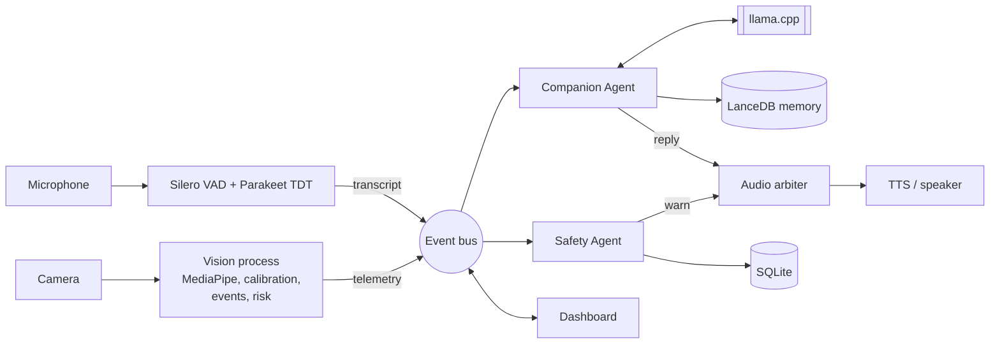

# Context-Aware Multi-Agent Driver Companion

An in-car assistant that watches for driver fatigue and distraction and talks with the driver, running entirely on the device. A camera pipeline estimates drowsiness from the face and upper body, a deterministic Safety Agent interrupts everything when the driver is in danger, and a voice companion backed by a local LLM keeps the driver engaged and remembers them across trips. No cloud services are needed; profile sync is optional and encrypted.

Final year project. The design follows the Implementation chapter of the project report; [docs/ARCHITECTURE.md](docs/ARCHITECTURE.md) maps each part of it to code.

## What it does

**Driver monitoring** (MediaPipe Face Landmarker + Pose Landmarker)
- Eye closure (EAR), PERCLOS over 60 s, blinks and microsleeps
- Yawns (MAR), head pose and head drops, gaze direction and eyes-off-road distraction
- Upper-body posture: shoulder tilt, lateral lean and slumping
- Per-driver calibration: robust baselines (median and scaled MAD) and personalised thresholds, saved per driver
- Drowsiness risk from a temporal model (a trained TCN through ONNX Runtime, or a transparent heuristic), smoothed and fused with instant safety triggers into three states: Alert, Mild, High
- A tracking-quality score that suppresses false alarms when the face is turned away or hidden

**Safety Agent** (deterministic, no LLM)
- High drowsiness: an urgent spoken warning
- Mild drowsiness: a check-in after 20 s; reminders for distraction, slumped posture and a hidden face
- A watchdog for a lost camera signal; events logged to SQLite

**Voice companion**
- Silero VAD v5 and NVIDIA Parakeet TDT 0.6B v2 int8 (English) on the CPU, via sherpa-onnx
- No ASR language setting is needed; Parakeet v2 is English-only
- A LangGraph agent on a local llama.cpp model; its tone adapts to fatigue level and speech emotion
- Long-term memory of the driver's facts and preferences (LanceDB)
- Piper or OS text-to-speech, with safety warnings pre-rendered

**Dashboard** (React)
- Live risk gauge, eye and gaze metrics, head pose and posture; calibration status with a Recalibrate button
- Camera preview with tracked points, a 30 s timeline, chat, memories, sync status and a monitoring log
- A simulator with scenario buttons, so the whole system can be demonstrated without a camera

## Architecture



Vision runs in its own process, so speech recognition and the LLM can never slow it down. The orchestrator is a single asyncio event loop: speech recognition, text-to-speech and the database run in threads, and the LLM is a separate server. Safety warnings are spoken through the audio arbiter. The details, including every formula and threshold, are in [docs/ARCHITECTURE.md](docs/ARCHITECTURE.md).

## Tech stack

| Area | Technology |
|---|---|
| Backend | Python 3.10+, FastAPI, WebSocket, asyncio |
| Vision | MediaPipe Tasks (Face Landmarker, Pose Landmarker), OpenCV, NumPy, ONNX Runtime (TCN) |
| Speech-to-text | sherpa-onnx: Silero VAD v5 + Parakeet TDT 0.6B v2 int8 (CPU) |
| Text-to-speech | Piper, or pyttsx3 with OS voices |
| LLM | llama.cpp server (OpenAI-compatible), LangGraph |
| Storage | SQLite (aiosqlite), LanceDB |
| Sync | AES-256-GCM encrypted bundle |
| Dashboard | React 18, Tailwind CSS 4, Vite |

## Quick start

```powershell
python scripts/download_models.py --test-assets
cd backend; python -m venv .venv; .\.venv\Scripts\pip install -r requirements-dev.txt
cd ..\dashboard; npm install; npm run build
cd ..\backend; .\.venv\Scripts\python -m app.main
```

Then open http://127.0.0.1:8000. This starts the simulator. For the live camera, voice, a local LLM and the full configuration reference, see **[COMMANDS.md](COMMANDS.md)**.

## Repository layout

```
backend/
  app/
    agents/      Safety, Companion, Memory agents and the tone policy
    api/         FastAPI routes, WebSocket, dashboard hosting
    audio/       VAD, speech-to-text, language ID, emotion, TTS, audio arbiter
    vision/      MediaPipe landmarks, features, calibration, monitor, temporal model, worker process
    db/          SQLite schema and repository, LanceDB memory store
    llm/ memory/ sync/
  tests/         pytest suite (unit, model and end-to-end tests)
dashboard/       React + Tailwind dashboard (Vite)
docs/            Architecture
scripts/         download_models.py
models/          downloaded models (git-ignored)
```

## Testing

```powershell
cd backend; .\.venv\Scripts\python -m pytest
```

The suite has about 280 tests and runs in about 70 s. It covers:

- **Feature maths:** EAR, MAR, gaze and posture checked against hand-calculated geometry; head pose recovered from 20 random synthetic poses within 0.5°.
- **MediaPipe on real photos:** head pose against image rotation, mirroring, scale and position in the frame; gaze, posture, the profile view, VIDEO-mode timestamps and a camera source reading a video file.
- **Calibration and monitoring:** every rule (blinks vs microsleeps, yawns vs speech, head drops, mirror glances vs distraction, posture, tracking quality, the EMA, the risk levels), all seven simulator scenarios, and the ONNX TCN contract.
- **Voice:** VAD under four noise types down to 0 dB SNR, clicks, pauses, long speech, invariance to block size, and fallbacks for missing or corrupt models. Speech-to-text on four languages and any sample rate, plus the microphone listener and echo guard.
- **End to end:** the full app with the vision process, the WebSocket, SQLite, calibration storage and alerts; voice through a simulated microphone; API security (no path traversal).

## Performance

Measured on an Intel i5-13420H laptop CPU, no GPU:

| Stage | Cost |
|---|---|
| Vision (Face + Pose Landmarker and features, 640x480) | 4.5 ms per frame on average (p95 13 ms), comfortably 15 fps |
| VAD (Silero v5) | about 0.7 % of one core |
| Speech-to-text (4 threads) | about 1.3 s for a 4 s utterance (RTF 0.35) |
| Event-loop delay while transcribing | none measurable (decoding releases the GIL) |

## Limitations

- No trained TCN checkpoint is included; without `DC_TEMPORAL_MODEL` the drowsiness probability comes from the window heuristic.
- The yawn duration defaults to 1.2 s so ordinary real yawns are detected; set `DC_YAWN_SECONDS=5` to match the report's stricter value.
- Parakeet v2 is English-only and returns punctuation/capitalisation; number and spelling formatting may differ from other ASR engines.
- Speech emotion without a model (`DC_SER_MODEL`) is a rough loudness heuristic.
- Posture monitoring needs both shoulders in the camera's view.
- Profile sync is upload-only; restoring from the cloud is not implemented.

## Third-party models

| Model | Source | Licence |
|---|---|---|
| Parakeet TDT 0.6B v2 int8 | NVIDIA, exported by k2-fsa/sherpa-onnx | CC BY 4.0 (weights), Apache-2.0 (export) |
| Silero VAD v5 | snakers4/silero-vad, via sherpa-onnx | MIT |
| Face Landmarker, Pose Landmarker | Google MediaPipe | Apache-2.0 |
