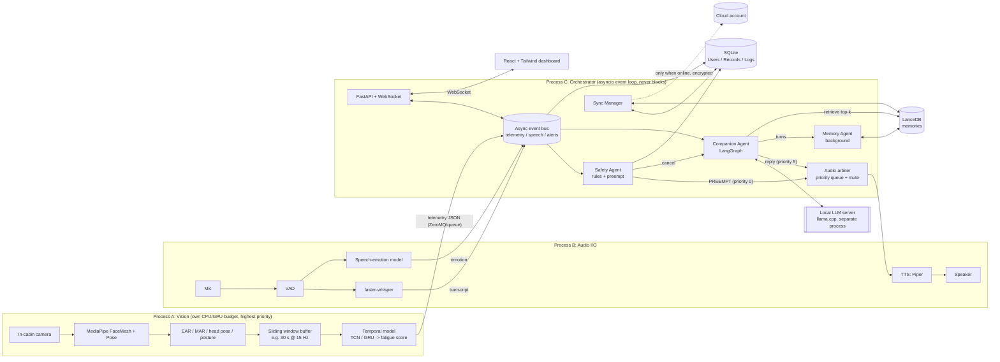

# Context-Aware Multi-Agent Driver Companion — Architecture

## 1. High-level diagram



## 2. Non-blocking guarantees

| Risk | Mitigation |
|---|---|
| LLM generation starves vision | Vision, audio and LLM run as **separate OS processes**; LLM is a llama.cpp server. The orchestrator only awaits HTTP/stream tokens. |
| CPU-bound work in event loop | STT/TTS/embedding/SQL calls go through `run_in_executor` or aiosqlite. No sync I/O in agents. |
| Safety latency | Safety Agent subscribes to telemetry on its own task and does not depend on the Companion. It only reads a rolling buffer. |
| Preemption | Audio arbiter holds one `current` playback and a priority heap (0 = safety, 5 = chat). Safety publishes `PREEMPT`, which cancels the Companion's generation task (`task.cancel()`), flushes the TTS queue, and plays the cached warning WAV (pre-rendered at startup, so no TTS/LLM is needed to warn). |
| Telemetry flooding | Bounded `asyncio.Queue` with drop-oldest policy; only the latest frame matters. |
| Vision crash | The Safety Agent has a watchdog: no telemetry for N s means "sensor lost" warning. |

Safety rule (default, configurable): `EAR < 0.20` continuously for `> 1.5 s`, or temporal-model `fatigue_score >= 0.8`, or `PERCLOS` over threshold; yawning (MAR) and head-nod raise the level.

## 3. Telemetry contract (Vision -> Orchestrator)

```json
{
  "ts": 1760000000.123,
  "face_detected": true,
  "ear": 0.17, "mar": 0.31,
  "head_pose": {"yaw": 4.2, "pitch": -18.0, "roll": 1.1},
  "posture": {"slump_score": 0.42, "shoulder_tilt": 3.0},
  "perclos_30s": 0.34,
  "eyes_closed_ms": 1620,
  "fatigue_score": 0.86,
  "drowsiness_level": "HIGH"
}
```

`drowsiness_level` in {`ALERT`, `MILD`, `MODERATE`, `HIGH`}.

## 4. Agents

- **Safety Agent**: deterministic, no LLM. Debounced state machine, writes `monitoring_logs`, emits `PREEMPT`.
- **Companion Agent**: LangGraph graph `perceive -> retrieve_memory -> build_prompt -> generate -> speak`. The tone policy takes `drowsiness_level` and speech-emotion, and goes into the system prompt. Interruptible at every node.
- **Memory Agent**: consumes a session `deque` of finished turns. Every N turns or at idle it asks the LLM to extract facts as JSON, embeds them (multilingual MiniLM / bge-small, ONNX), dedups by cosine, and upserts to LanceDB.

## 5. Data stores

- **SQLite (WAL mode)**: fixed-shape data (`backend/app/db/schema.sql`).
- **LanceDB**: `memories` table with `context_text, embedding, category, topic, user_id` (`backend/app/db/vector_store.py`).
- **Sync**: `profile_bundle = sqlite backup + lancedb export -> zstd -> AES-256-GCM (key from OS keyring / scrypt passphrase) -> upload`. Runs only when a connectivity probe succeeds and the vehicle is stationary or idle. It is a background task with exponential backoff. Conflict rule: per-row `updated_at`, last-writer-wins, and tombstones for deletions.

## 6. Directory structure

```
fyp-new/
├─ docs/ARCHITECTURE.md
├─ backend/
│  ├─ pyproject.toml
│  └─ app/
│     ├─ main.py                  # starts bus, agents, API
│     ├─ config.py
│     ├─ bus.py                   # async pub/sub, drop-oldest queues
│     ├─ contracts.py             # pydantic: Telemetry, Transcript, Alert
│     ├─ db/
│     │  ├─ schema.sql
│     │  ├─ relational.py         # aiosqlite + repositories
│     │  └─ vector_store.py       # LanceDB memory store
│     ├─ vision/                  # separate process
│     │  ├─ capture.py  features.py  window.py  temporal_model.py  worker.py
│     ├─ audio/                   # separate process
│     │  ├─ stt.py  tts.py  emotion.py  arbiter.py
│     ├─ agents/
│     │  ├─ safety.py  companion.py  memory.py  tone_policy.py
│     ├─ llm/client.py            # llama.cpp HTTP streaming client
│     ├─ sync/manager.py  sync/crypto.py
│     └─ api/server.py            # FastAPI + WS
└─ dashboard/                     # Vite + React + Tailwind
   └─ src/ (components: DriverState, LiveGauges, AlertBanner, ChatPane, History)
```

## 7. Suggested local model stack

Vision: MediaPipe FaceMesh/Pose + small TCN (PyTorch -> ONNX). STT: faster-whisper (small/int8). TTS: Piper. LLM: Qwen2.5-7B-Instruct Q4 (or 3B on weaker hardware) via llama.cpp. Speech emotion: wav2vec2/emotion2vec small ONNX. Embeddings: multilingual-e5-small ONNX.

## 8. Build order

1. DB layer (this step) -> 2. contracts + bus -> 3. vision features + window + telemetry -> 4. Safety agent + audio arbiter -> 5. LLM client + Companion -> 6. Memory agent -> 7. API + dashboard -> 8. Sync manager.
