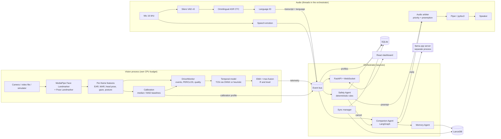

# Architecture

This document describes how the system is built. For setup see [COMMANDS.md](../COMMANDS.md); for an overview see the [README](../README.md).

## 1. Processes and data flow



| Component | Where it runs | Code |
|---|---|---|
| Vision pipeline | separate OS process (`multiprocessing`, spawn) | `app/vision/` |
| Speech-to-text, VAD | background thread | `app/audio/stt.py`, `vad.py`, `language.py` |
| Text-to-speech, playback | executor threads behind the audio arbiter | `app/audio/tts.py`, `arbiter.py` |
| Agents, API, bus | asyncio event loop | `app/agents/`, `app/api/`, `app/bus.py` |
| LLM | llama.cpp server (OpenAI-compatible HTTP) | `app/llm/client.py` |

## 2. Non-blocking guarantees

| Risk | Mitigation |
|---|---|
| LLM or speech work starves vision | Vision is its own process; the LLM is a separate server. |
| Blocking work in the event loop | ASR, TTS, embeddings and LanceDB run in threads/executors. ASR decoding releases the GIL (measured: event-loop tick gaps unchanged while transcribing). |
| Safety latency | The Safety Agent has its own task that reads telemetry directly; it never waits for the companion. |
| Preemption | The arbiter keeps one playback and a priority queue (0 = safety, 5 = chat). A warning cancels the companion's generation, flushes queued chat and mutes chat for 10 s. Warnings are pre-rendered at start-up. |
| Telemetry flooding | Bounded queues drop the oldest item; only the latest frame matters. |
| Vision crash | Watchdog: no telemetry for 3 s gives a "camera signal lost" warning. |
| The companion hearing itself | Audio captured while the companion speaks (and 0.3 s after) is discarded; the decision is made in the audio callback, at capture time. |

## 3. Vision pipeline (Implementation ch. 6.2-6.4)

**Landmarks.** MediaPipe Tasks in VIDEO mode: Face Landmarker (478 points including the irises, plus the facial transformation matrix) on every frame, Pose Landmarker (33 points) on every 5th frame; posture changes slowly and the cached pose expires after 1 s. Frames are processed unmirrored; only the dashboard preview is mirrored. Measured on an i5-13420H at 640x480: 4.5 ms per frame on average, 13 ms at the 95th percentile.

**Per-frame features** (`features.py`):

| Feature | Definition |
|---|---|
| EAR | (‖p2−p6‖ + ‖p3−p5‖) / (2‖p1−p4‖), averaged over both eyes (6.5) |
| MAR | (‖q3−q4‖ + ‖q5−q6‖ + ‖q7−q8‖) / (3‖q1−q2‖), inner-lip points (6.7) |
| Head pose | Rotation from the Face Landmarker's facial transformation matrix, Euler angles by (6.10). 6-point PnP (6.9) is the fallback. |
| Gaze | g_h = (c_x − co_x)/(ci_x − co_x) − 0.5, g_v = (c_y − eu_y)/(el_y − eu_y) − 0.5 per eye (6.11); undefined while the eye is closed |
| Posture | shoulder tilt θ, lateral lean λ = (n_x − m_x)/w, head height δ = (m_y − n_y)/w (6.12-6.13), in pixels so they are scale-invariant |

Why the matrix and not PnP for head pose: against MediaPipe's own fit, 6-point PnP was 13-20° off in pitch on frontal faces and moved about 20° when the same face sat higher in the frame. Before calibration, that would have read as a head drop.

Sign conventions: pitch < 0 = head down; yaw > 0 = turned towards the image's right (the driver's left); roll > 0 = clockwise in the image; gaze h > 0 = towards the image's right.

**Calibration** (`calibration.py`). At the start of every session, and on request, the first 10 s of usable neutral frames (face found, |yaw| ≤ 35°, |pitch| ≤ 40°) give per-feature baselines x_base = median and σ = 1.4826 · MAD (6.1-6.2). Thresholds are personal: τ_EAR = 0.70 · EAR_base (6.3), τ_MAR = MAR_base + 0.40 (6.4). Profiles are stored per driver in SQLite and loaded at the next start, so the driver is monitored with their own thresholds from the first frame. A calibration that sees too few usable frames keeps the previous profile.

**DriverMonitor** (`monitor.py`), every frame:

| Signal | Rule |
|---|---|
| Blink | closure shorter than 0.5 s |
| Microsleep (long closure) | EAR < τ_EAR continuously for ≥ 1.5 s (one noisy frame tolerated) |
| PERCLOS | share of usable frames with EAR < τ_EAR over the last 60 s (6.15) |
| Yawn | MAR > τ_MAR continuously for ≥ 3 s (strictly continuous, so speech never merges into a yawn) |
| Head drop | pitch ≤ −20° from neutral for ≥ 1.5 s |
| Eyes off road | \|yaw\| ≥ 20° or \|g_h\| ≥ 0.15 from baseline; distracted after 2 s |
| Posture instability | D_t = max(\|θ−θ_b\|/10°, \|λ−λ_b\|/0.20, max(0, 1−δ/δ_b)/0.25) > 1 for 5 s (6.14) |
| Quality | share of frames over 2 s with a tracked face and \|yaw\| ≤ 45°. Steep pitch does not lower it: that is a drowsiness sign, not bad tracking. |

**Temporal estimate and risk.** Every 5 frames, p_t comes from a trained TCN (ONNX Runtime, input `[1, 45, 7]`: ear_norm, mar_rel, pitch, yaw, roll, gaze_h, gaze_v) when `DC_TEMPORAL_MODEL` is set. Otherwise it comes from a noisy-OR heuristic over the 60 s window (PERCLOS anchored at 15 % → 0.5 and 30 % → 0.9, microsleeps, yawns, head drops). Then p̂_t = 0.3 · p_t + 0.7 · p̂_{t−1} (6.16) and R_t = max(p̂_t, r_t), with r_t = 1 during a microsleep or head drop (6.17). While quality is below 0.5, p̂ is held and r_t = 0, so occlusion and head turns cannot raise false alarms.

| Level | Risk | Behaviour |
|---|---|---|
| ALERT | R < 0.50 | normal conversation |
| MILD | 0.50 ≤ R < 0.85 | shorter, simpler, engaging replies; spoken check-in after 20 s, then not again for 120 s |
| HIGH | R ≥ 0.85 | urgent warning, all chat stopped and muted; repeated every 6 s |

## 4. Telemetry contract (vision → orchestrator, one message per frame)

```json
{
  "ts": 1764000000.12, "face_detected": true, "quality": 1.0,
  "ear": 0.31, "ear_norm": 0.97, "mar": 0.06, "mar_rel": 0.0,
  "head_pose": {"yaw": -2.0, "pitch": 1.0, "roll": -1.0},
  "gaze": {"h": 0.01, "v": 0.02, "on_road": true, "off_road_ms": 0, "distracted": false},
  "posture": {"visible": true, "shoulder_tilt": 0.0, "lean": 0.02, "head_height": 0.58,
              "slump_score": 0.0, "deviation": 0.1, "unstable": false},
  "window_s": 60, "perclos": 0.06, "eyes_closed_ms": 0,
  "blinks": 16, "long_closures": 0, "yawns": 0, "head_drops": 0,
  "yawning": false, "head_drop": false,
  "fatigue_score": 0.04, "risk": 0.04, "drowsiness_level": "ALERT",
  "calibration": {"state": "calibrated", "progress": 1.0, "ear_threshold": 0.224, "mar_threshold": 0.46},
  "source": "camera", "note": ""
}
```

The schema is `app/contracts.py`. Angles and gaze are relative to the driver's calibrated neutral.

## 5. Voice pipeline

1. **Capture.** 16 kHz mono, 50 ms blocks. Each block carries a "muted" flag set in the callback while the companion speaks.
2. **VAD.** Silero VAD v5 through sherpa-onnx (CPU, about 0.7 % of one core). Utterances end after 0.8 s of silence, so shorter pauses stay inside one utterance. Sounds under 0.25 s are ignored, and speech longer than 20 s is split. Each segment is re-cut with 0.4 s / 0.3 s of context, which measurably lowers the ASR error rate. If the model is missing, an energy VAD takes over; it only works in a quiet room.
3. **ASR.** Meta Omnilingual ASR 300M CTC v2 int8 through sherpa-onnx, CPU only, 4 threads: about 1.3 s for a 4 s utterance. The output is lowercase without punctuation.
4. **Language ID** (`language.py`). The model does not report the language, so it is inferred from the transcript: the script settles non-Latin languages (Urdu vs Arabic vs Persian by letters only one of them uses), and a function-word vote decides en/es/fr/de/pt/it/tr. If unsure, the session language is kept.

VAD choice, measured on speech mixed into synthetic cabin, pink and white noise from 20 dB down to 0 dB SNR:

| VAD | False triggers on pure noise | Utterances found in cabin noise | CER at white noise, 0 dB SNR |
|---|---|---|---|
| energy threshold | 19 | 0 / 16 | — |
| Silero v4 | 1 | 16 / 16 | 0.58 |
| **Silero v5** | **0** | **16 / 16** | **0.20** |
| TEN-VAD | 2 | 16 / 16 | 0.93 |

## 6. Data stores

- **SQLite** (WAL), schema in `app/db/schema.sql`: `users`, `monitoring_records` (one per session), `monitoring_logs` (state changes, debounced by 1 s, and every alert with its prompt), `calibration_profiles` (last 10 per driver), `sync_state`.
- **LanceDB**: `memories` (`context_text`, 384-d `embedding`, `category`, `topic`, `user_id`).
- **Sync**: SQLite snapshot + LanceDB → zip → AES-256-GCM → upload when online (or `data/cloud_outbox/`).

## 7. Directory structure

```
backend/app/
  main.py, config.py, runtime.py, bus.py, contracts.py, state.py
  api/server.py                FastAPI routes + WebSocket, serves the built dashboard
  agents/                      safety.py, companion.py, memory.py, tone_policy.py
  audio/                       stt.py, vad.py, language.py, emotion.py, tts.py, arbiter.py
  vision/                      worker.py, landmarks.py, features.py, calibration.py,
                               monitor.py, temporal_model.py
  db/                          schema.sql, relational.py, vector_store.py
  llm/client.py  memory/embeddings.py  sync/manager.py
backend/tests/                 pytest suite
dashboard/src/                 React + Tailwind (Vite)
scripts/download_models.py     fetches and verifies all model files into models/
```
