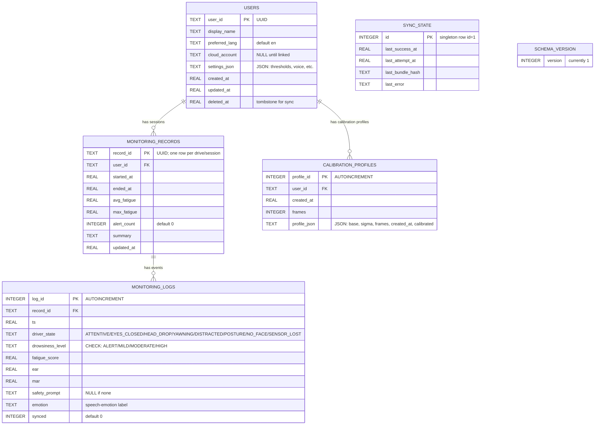
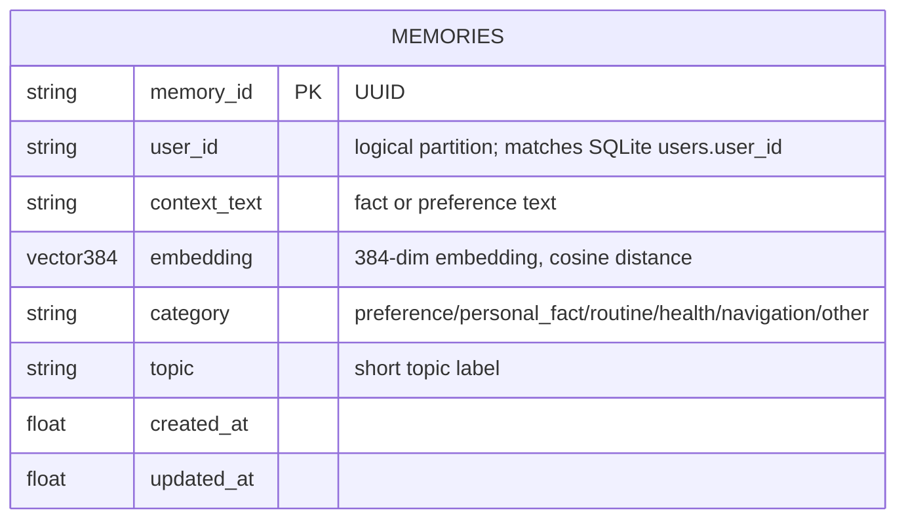
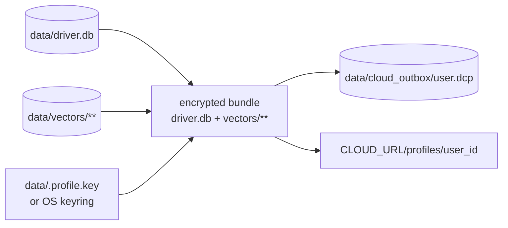

# Database schemas

The app uses two local stores under one data directory:

- SQLite relational store: `data/driver.db`
- LanceDB vector store: `data/vectors/`

`DATA_DIR` overrides the parent directory. Timestamps are Unix epoch seconds stored as `REAL`.

## 1. SQLite — `data/driver.db`

Source of truth: [`backend/app/db/schema.sql`](../backend/app/db/schema.sql).

Indexes and pragmas:

- `PRAGMA journal_mode = WAL`, `foreign_keys = ON`, `synchronous = NORMAL`
- `idx_records_user_time(user_id, started_at DESC)`
- `idx_logs_record_ts(record_id, ts)`
- `idx_logs_unsynced(synced) WHERE synced = 0`
- `idx_calibration_user_time(user_id, created_at DESC)`

Notes:

- The newest `calibration_profiles` row is the active driver baseline; only the latest 10 rows per user are kept.
- `profile_json` contains robust neutral baselines: `base` and `sigma` values for `ear`, `mar`, head pose, gaze and posture features.
- `sync_state` is a singleton bookkeeping row. The actual encrypted sync bundle is a separate file, not a DB table.

## 2. LanceDB — `data/vectors/`

Source of truth: [`backend/app/db/vector_store.py`](../backend/app/db/vector_store.py). The table is named `memories`; this is the long-term memory store.

Notes:

- `user_id` is not an enforced foreign key in LanceDB, but it logically matches `USERS.user_id` in SQLite.
- Inserts are skipped when cosine similarity to an existing memory for the same user is `>= 0.92`.
- Retrieval keeps results with cosine score `>= 0.35`; the dashboard limit is 200 rows per user.
- Embeddings come from the configured sentence-transformer model; `EMBED_DIM = 384`.

## Cross-store sync bundle

The sync manager packages both stores into one encrypted `DCP1` blob (`data/cloud_outbox/<user_id>.dcp` by default, or `CLOUD_URL` when configured).

